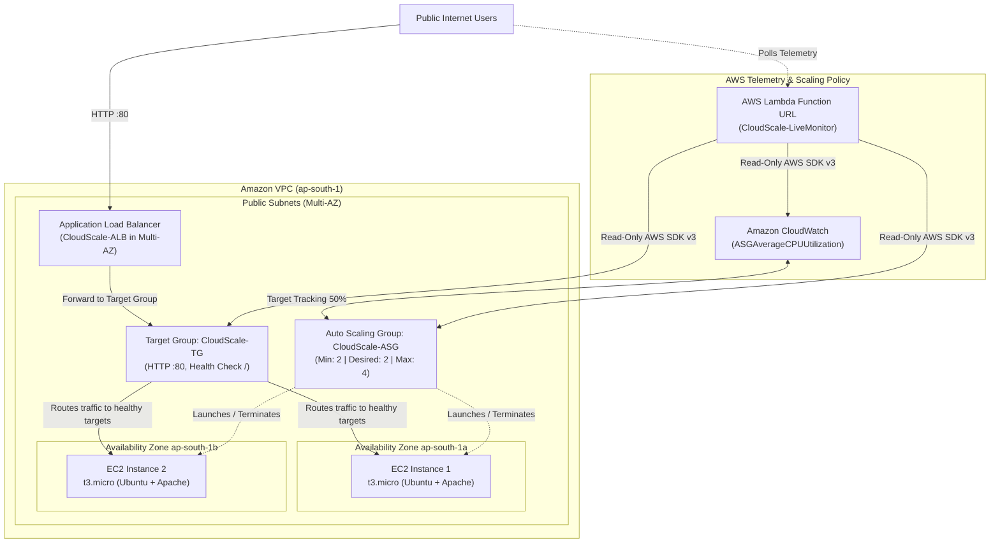

# CloudScale — Scalable & Highly Available Web Application on AWS

> **A production-grade cloud infrastructure project featuring an Application Load Balancer (ALB), an EC2 Auto Scaling Group with CPU target tracking, Multi-AZ high availability, and real-time AWS telemetry.**

[](http://CloudScale-ALB-68735344.ap-south-1.elb.amazonaws.com)
[-1E88E5)](#aws-architecture)
[](#testing-and-verification)
[](package.json)

---

## 🚀 Live Demo

- **Live Website:** [http://CloudScale-ALB-68735344.ap-south-1.elb.amazonaws.com](http://CloudScale-ALB-68735344.ap-south-1.elb.amazonaws.com)
- **GitHub Repository:** [https://github.com/arnav365/cloudscale-alb-autoscaling](https://github.com/arnav365/cloudscale-alb-autoscaling)
- **AWS Region:** Asia Pacific (Mumbai), `ap-south-1`

The web application is deployed on Amazon EC2 instances distributed across two Availability Zones behind **`CloudScale-ALB`**, an internet-facing Application Load Balancer. The ALB distributes incoming HTTP traffic across healthy target instances registered in **`CloudScale-TG`**. 

> **Protocol Note:** Served over **HTTP** through the Application Load Balancer's public AWS DNS endpoint. HTTPS / TLS encryption is not configured yet (documented under [Future Enhancements](#future-enhancements)).

---

## Table of Contents

1. [Project Overview](#project-overview)
2. [Problem Statement](#problem-statement)
3. [Key Features](#key-features)
4. [AWS Architecture](#aws-architecture)
5. [AWS Services Used](#aws-services-used)
6. [Technology Stack](#technology-stack)
7. [Project Structure](#project-structure)
8. [Run Locally](#run-locally)
9. [AWS Deployment & Infrastructure Setup](#aws-deployment--infrastructure-setup)
10. [Testing and Verification](#testing-and-verification)
11. [Monitoring: Live Telemetry vs. Frontend Simulation](#monitoring-live-telemetry-vs-frontend-simulation)
12. [Security and Cost Considerations](#security-and-cost-considerations)
13. [Future Enhancements](#future-enhancements)
14. [Author & Repository](#author--repository)

---

## Project Overview

Modern production web applications must withstand traffic fluctuations and infrastructure failures without human intervention. Traditional single-server hosting introduces a single point of failure and rigid capacity constraints that either lead to downtime during traffic spikes or waste money through idle, overprovisioned resources.

**CloudScale solves these challenges** through horizontal elasticity and fault tolerance:
- **Application Load Balancing:** Distributes incoming user requests evenly across healthy web server instances.
- **Automated Horizontal Scaling:** Adds compute instances dynamically when CPU utilization exceeds 50%, and terminates excess capacity when load subsides.
- **Multi-AZ Availability:** Eliminates single points of failure by spreading EC2 capacity across isolated data centers (`ap-south-1a` and `ap-south-1b`).
- **Live AWS Telemetry:** Features a serverless read-only Lambda backend that queries live AWS infrastructure metrics (ASG capacity, EC2 target health, and CloudWatch CPU utilization) and renders real-time state directly on the web console.

| Specification | Implementation Details |
| --- | --- |
| **Cloud Provider** | Amazon Web Services (AWS) |
| **Region & AZs** | `ap-south-1` (Mumbai) · `ap-south-1a`, `ap-south-1b` |
| **Compute** | Amazon EC2 — `t3.micro` instances, Ubuntu 24.04 LTS, Apache HTTP Server |
| **Load Balancer** | Application Load Balancer (Layer 7), Internet-facing, HTTP port 80 listener |
| **Auto Scaling** | EC2 Auto Scaling Group (`CloudScale-ASG`), Min: 2, Desired: 2, Max: 4 |
| **Scaling Policy** | Target Tracking on `ASGAverageCPUUtilization` at 50% target |
| **Telemetry Backend** | AWS Lambda (Node.js 20.x, ARM64) with read-only AWS SDK v3 via Function URL |
| **Front End** | HTML5, CSS3 (vanilla custom dark glass design system), Vanilla JavaScript (no frameworks) |

---

## Problem Statement

Single-server architectures suffer from two fundamental design flaws:

1. **Traffic Saturation:** When incoming requests surge past a single server's throughput limits, CPU and memory saturate, response latencies spike, and requests drop. Scaling vertically by purchasing a larger server is expensive and requires manual downtime.
2. **Single Point of Failure (SPOF):** If a single host suffers a hardware failure, OS kernel panic, or an Availability Zone network disruption, the entire service goes offline immediately.

CloudScale implements **horizontal elasticity**: stateless EC2 instances run behind a health-checked target group, allowing instances to be launched or terminated on demand without dropping connections or impacting end users.

---

## Key Features

### Infrastructure & Cloud Engineering
- **Layer 7 Request Routing:** ALB routes HTTP traffic to healthy targets and automatically skips instances failing health checks.
- **Autonomous Target Tracking:** Scaling policy automatically calculates instance requirements based on 50% average CPU utilization without complex threshold alarms.
- **Multi-AZ Redundancy:** EC2 instances are balanced between `ap-south-1a` and `ap-south-1b`, surviving a full AZ outage.
- **Golden Launch Template:** `CloudScale-Launch-Template` ensures every scaled instance boots with identical packages, configuration, and website files via cloud-init user data.
- **Zero-Trust Network Perimeter:** Security groups restrict direct web access to the EC2 instances; compute nodes accept HTTP traffic strictly from the ALB's security group.

### Web Application & Telemetry
- **Interactive AWS Architecture Diagram:** Component-level interactive diagram showing request flow from the public internet down to the EC2 fleet.
- **Live AWS Infrastructure Monitor:** Dedicated dashboard section connected to a read-only Lambda Function URL, displaying real-time ASG desired/in-service counts, target health, and CloudWatch CPU metrics.
- **Frontend Scaling & Failure Simulator:** Browser-based simulation allowing users to test scaling logic (Low, Normal, High, Peak) and visualize failover routing without modifying production resources.
- **Zero Dependencies / Ultra Lightweight:** Vanilla HTML, CSS, and JavaScript with 100% native browser support, dark mode glassmorphism, responsive mobile layouts, and `prefers-reduced-motion` compliance.

---

## AWS Architecture



### Architecture Flow
1. **Client Request:** An HTTP request hits the DNS endpoint of **`CloudScale-ALB`**.
2. **Listener & Evaluation:** The ALB listener on port 80 evaluates target health and forwards requests to registered targets in **`CloudScale-TG`**.
3. **Target Group Routing:** Requests are routed only to healthy EC2 instances passing HTTP health checks on `/`.
4. **Web Server Response:** The selected EC2 instance running Apache HTTP Server serves the static application.
5. **Metric Aggregation:** EC2 instances report CPU utilization to Amazon CloudWatch, which aggregates the group average into `ASGAverageCPUUtilization`.
6. **Dynamic Scaling:** If average CPU exceeds 50%, Auto Scaling launches additional `t3.micro` instances up to a maximum of 4. When load subsides, excess instances are gracefully terminated down to the minimum of 2.
7. **Telemetry API:** The client website periodically queries the read-only AWS Lambda Function URL to fetch live instance counts, health states, and CloudWatch metrics.

---

## AWS Services Used

| Service | Resource Name / Identifier | Status | Purpose |
| --- | --- | --- | --- |
| **Amazon EC2** | `t3.micro` (Ubuntu 24.04 LTS) | **Deployed** | Hosts Apache HTTP Server serving application assets. |
| **EC2 Launch Template** | `CloudScale-Launch-Template` | **Deployed** | Defines AMI, instance type, security groups, and automated user data startup script. |
| **Application Load Balancer** | `CloudScale-ALB` | **Deployed** | Internet-facing Layer 7 load balancer spanning multiple AZs. |
| **Target Group** | `CloudScale-TG` | **Deployed** | Manages registered EC2 instances with active HTTP `/` health checks. |
| **EC2 Auto Scaling** | `CloudScale-ASG` | **Deployed** | Enforces fleet bounds (2–4 instances) and coordinates horizontal scaling. |
| **Amazon CloudWatch** | `ASGAverageCPUUtilization` | **Deployed** | Collects CPU metrics and triggers target tracking alarms. |
| **Amazon VPC** | Multi-AZ Subnets | **Deployed** | Network isolation across `ap-south-1a` and `ap-south-1b`. |
| **Security Groups** | `CloudScale-EC2-SG`, `ALB-SG` | **Deployed** | Stateful firewall limiting instance access strictly to ALB traffic and admin SSH. |
| **AWS Lambda** | `CloudScale-LiveMonitor` | **Deployed** | Serverless telemetry backend providing live AWS infrastructure metrics via Function URL. |
| **AWS IAM** | `CloudScale-LiveMonitor-Role` | **Deployed** | Least-privilege read-only role for Lambda telemetry queries. |
| **AWS Certificate Manager** | Planned | *Planned* | TLS certificate provisioning for HTTPS port 443 termination. |
| **Amazon Route 53** | Planned | *Planned* | Custom apex domain and DNS latency routing. |

---

## Technology Stack

- **Frontend:**
  - **HTML5:** Semantic document structure, SEO metadata, accessible landmarks, and SVG diagrams.
  - **CSS3:** Custom design tokens, glassmorphism surfaces, responsive grid layouts, and micro-animations.
  - **Vanilla JavaScript (ES6+):** Zero-dependency reactive UI state, architecture interaction handlers, and live telemetry polling.
- **Backend & Telemetry:**
  - **Node.js 20.x:** Lightweight ESM handler (`backend/index.mjs`) deployed on AWS Lambda ARM64.
  - **AWS SDK v3:** Read-only client libraries (`@aws-sdk/client-auto-scaling`, `@aws-sdk/client-ec2`, `@aws-sdk/client-elastic-load-balancing-v2`, `@aws-sdk/client-cloudwatch`).
- **Tooling & Local Dev:**
  - **Node.js / npm:** Configured with `package.json` scripts using `serve`.
  - **Python 3:** Alternate zero-dependency local HTTP server.

---

## Project Structure

```
cloudscale-alb-autoscaling/
├── index.html              # Main application: hero, architecture diagram, live monitor,
│                           # interactive simulator, verification checklist, security specs
├── style.css               # Complete stylesheet: design tokens, dark glassmorphism,
│                           # responsive rules, and hardware-accelerated animations
├── script.js               # Application logic: simulation engine, diagram interactions,
│                           # SVG chart rendering, and live AWS Lambda telemetry integration
├── package.json            # Node.js project manifest with local development scripts
├── .gitignore              # Ignores node_modules, environment variables, logs, and OS caches
├── README.md               # Project documentation, architecture specs, and testing results
│
├── backend/                # Serverless read-only telemetry backend
│   ├── index.mjs           # AWS Lambda handler (Node.js 20.x ESM, AWS SDK v3)
│   ├── iam-policy.json     # Least-privilege read-only IAM policy for Lambda role
│   └── README.md           # Backend architecture, IAM setup, and deployment guide
│
└── assets/                 # Static project assets directory
```

---

## Run Locally

The website frontend is static and can run locally without any AWS credentials or local cloud emulators.

### Prerequisites
- Node.js (v18+) or Python 3.x
- Git

### 1. Clone the repository
```bash
git clone https://github.com/arnav365/cloudscale-alb-autoscaling.git
cd cloudscale-alb-autoscaling
```

### 2. Start the local server

Using npm (Node.js):
```bash
# Starts local development server on port 8000
npm run dev

# Or run:
npm start
```

Using Python:
```bash
npm run serve:py
# Equivalent to: python -m http.server 8000
```

### 3. Open the application
Navigate to **`http://localhost:8000`** in any web browser. You can also open `index.html` directly in your browser using the `file://` protocol.

---

## AWS Deployment & Infrastructure Setup

The infrastructure was deployed in AWS region **`ap-south-1` (Mumbai)** using the following procedure:

### 1. Network Configuration
- Configured public subnets in **`ap-south-1a`** and **`ap-south-1b`** attached to an Internet Gateway.

### 2. Security Groups
- **`CloudScale-ALB-SG`:** Allows inbound HTTP (`TCP :80`) from `0.0.0.0/0`.
- **`CloudScale-EC2-SG`:**
  - Inbound HTTP (`TCP :80`) allowed **only from `CloudScale-ALB-SG`**.
  - Inbound SSH (`TCP :22`) restricted to the administrator's trusted IP address.

### 3. Launch Template (`CloudScale-Launch-Template`)
- **AMI:** Ubuntu Server 24.04 LTS (HVM), SSD Volume Type
- **Instance Type:** `t3.micro`
- **Security Group:** `CloudScale-EC2-SG`
- **User Data Script (`cloud-init`):**
  ```bash
  #!/bin/bash
  apt update -y
  apt install -y apache2
  systemctl enable --now apache2
  
  # Deploy CloudScale website files into the web root
  # Files: index.html, style.css, script.js
  ```

### 4. Target Group (`CloudScale-TG`)
- **Target Type:** Instances
- **Protocol / Port:** HTTP : 80
- **Health Check Path:** `/`
- **Health Check Thresholds:** 2 consecutive successes to mark Healthy, 2 failures to mark Unhealthy.

### 5. Application Load Balancer (`CloudScale-ALB`)
- **Scheme:** Internet-facing
- **IP Address Type:** IPv4
- **VPC Subnets:** Attached to both `ap-south-1a` and `ap-south-1b`.
- **Listener:** HTTP : 80 forwarding to `CloudScale-TG`.

### 6. Auto Scaling Group (`CloudScale-ASG`)
- **Launch Template:** `CloudScale-Launch-Template`
- **Capacity Limits:** Minimum: `2`, Desired: `2`, Maximum: `4`
- **Subnets:** Spans both Availability Zones.
- **Target Group Attachment:** `CloudScale-TG`
- **Health Check Type:** ELB (evaluates target group health checks in addition to EC2 status checks).

### 7. Target Tracking Scaling Policy
- **Metric Type:** `ASGAverageCPUUtilization`
- **Target Value:** `50.0%`
- **Warmup Time:** 300 seconds

---

## Testing and Verification

To verify that the infrastructure scales automatically without manual intervention, real CPU stress was applied to the live instances.

### Load Test Procedure
1. **Steady-State Baseline:** Verified `CloudScale-ASG` was running 2 healthy instances (1 in `ap-south-1a`, 1 in `ap-south-1b`).
2. **Traffic Verification:** Opened the ALB DNS endpoint to confirm Apache served the website from both instances.
3. **Generating CPU Load:** Connected to the instances via SSH and ran `stress-ng` to saturate compute cores:
   ```bash
   sudo apt update && sudo apt install -y stress-ng
   stress-ng --cpu 2 --timeout 600s
   ```
4. **CloudWatch Alarm Trigger:** CloudWatch metric `ASGAverageCPUUtilization` climbed past the 50% threshold.
5. **Observed Scale-Out:** Auto Scaling automatically launched a 3rd `t3.micro` instance. The new instance ran user data, registered with `CloudScale-TG`, passed health checks, and received ALB traffic.
6. **Removing Stress Load:** Terminated the `stress-ng` process. CPU utilization returned to baseline (<10%).
7. **Observed Scale-In:** Auto Scaling detected sustained utilization below target and terminated the extra instance, safely returning desired capacity to 2.

### Summary of Observed Results

| Test Stage | Fleet Count | Target Health | Average CPU | System Action |
| --- | :---: | :---: | :---: | --- |
| **1. Baseline** | 2 | 2 Healthy | ~8% | Steady state (min capacity held) |
| **2. Load Generated** | 2 | 2 Healthy | >50% | CloudWatch alarm fires |
| **3. Scale-Out** | **3** | 3 Healthy | ~45% | **ASG launches 3rd instance automatically** |
| **4. Load Relieved** | 3 | 3 Healthy | ~6% | Cool-down period evaluated |
| **5. Scale-In** | **2** | 2 Healthy | ~5% | **ASG terminates extra instance automatically** |

---

## Monitoring: Live Telemetry vs. Frontend Simulation

The web interface features two distinct evaluation layers:

### 1. Live AWS Infrastructure Monitor
- **Mechanism:** Powered by a serverless backend (`backend/index.mjs`) deployed as an AWS Lambda Function URL.
- **Data Source:** Makes authenticated, read-only calls to the AWS SDK v3 to retrieve active `DescribeAutoScalingGroups`, `DescribeTargetHealth`, and CloudWatch `GetMetricData` metrics.
- **Integrity:** Displays exact live data from `ap-south-1`. If the Lambda service is unreachable or credentials expire, the UI explicitly flags data as stale or offline.

### 2. Interactive Frontend Simulator
- **Mechanism:** Browser-based simulation driven by `script.js`.
- **Purpose:** Designed for live portfolio demonstrations, stakeholder presentations, and interview walkthroughs.
- **Functionality:** Allows the user to cycle through traffic tiers (Low, Normal, High, Peak) and trigger simulated instance failures to demonstrate failover routing and load rebalancing without modifying live AWS infrastructure.

---

## Security and Cost Considerations

### Security Best Practices Implemented
- **Network Isolation:** EC2 instances do not accept direct web traffic from the public internet (`0.0.0.0/0`). Only the ALB security group is authorized on port 80.
- **Administrative Access:** SSH port 22 is restricted to a single administrator IP address.
- **Least-Privilege IAM Policy:** The Lambda telemetry function uses a custom IAM policy (`backend/iam-policy.json`) strictly granting `Describe*` and `GetMetricData` permissions. Write and administrative actions are explicitly disallowed.
- **Stateless Hosts:** Web servers store no customer data, secrets, or persistent credentials. Instances can be terminated and replaced without data loss.

### Cost Optimization
- **AWS Free Tier Compatibility:** Built using `t3.micro` EC2 instances (eligible for 750 monthly hours under the AWS Free Tier).
- **Scale-In Capacity Bounds:** Desired and minimum capacity are locked at 2 instances to minimize baseline running costs while maintaining high availability.
- **Serverless Telemetry:** The Lambda monitoring backend incurs charges only per invocation (well within the 1 million free monthly requests).

---

## Future Enhancements

- **HTTPS / TLS Encryption:** Issue a public SSL/TLS certificate via **AWS Certificate Manager (ACM)** and add an HTTPS port 443 listener with HTTP-to-HTTPS automatic redirection.
- **Custom Apex Domain:** Configure **Amazon Route 53** with alias records pointing to the ALB DNS name.
- **Private Subnet Isolation:** Place EC2 instances in private VPC subnets with a NAT Gateway for outbound patch management, preventing instances from having public IP addresses.
- **Real-Time Event Alerts:** Configure **Amazon SNS** topics attached to Auto Scaling lifecycle notifications to email administrators on scale-out or scale-in events.
- **Infrastructure as Code (IaC):** Replicate the entire VPC, ALB, ASG, and Lambda stack as modular **Terraform** or **AWS CloudFormation** templates.

---

## Author & Repository

- **Author:** Arnav ([@arnav365](https://github.com/arnav365))
- **Project Repository:** [https://github.com/arnav365/cloudscale-alb-autoscaling](https://github.com/arnav365/cloudscale-alb-autoscaling)
- **Live AWS Deployment:** [http://CloudScale-ALB-68735344.ap-south-1.elb.amazonaws.com](http://CloudScale-ALB-68735344.ap-south-1.elb.amazonaws.com)

---
*Distributed under the ISC License. See `package.json` for details.*
