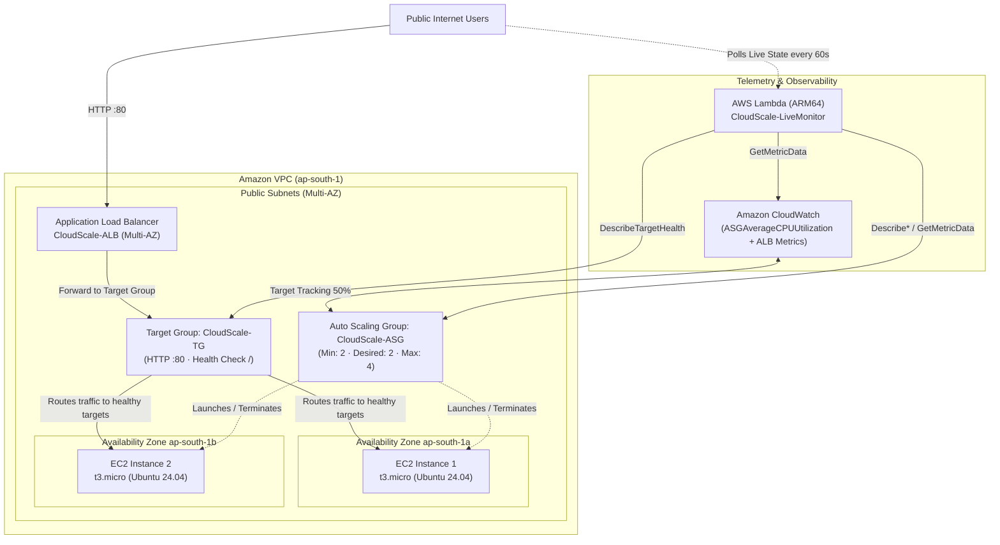

# CloudScale — Scalable & Highly Available Web Application on AWS

> **A production-grade cloud architecture featuring an internet-facing Application Load Balancer (ALB), an autonomous EC2 Auto Scaling Group with CPU target tracking across multiple Availability Zones, and a serverless real-time AWS telemetry dashboard.**

[](http://CloudScale-ALB-68735344.ap-south-1.elb.amazonaws.com)
[-1E88E5)](#aws-architecture)
[](#load-testing-and-autoscaling-verification)
[](package.json)

---

## 🌐 Live Demo & Endpoints

| Resource | Endpoint / Reference | Status |
| :--- | :--- | :--- |
| **Live Application** | [http://CloudScale-ALB-68735344.ap-south-1.elb.amazonaws.com](http://CloudScale-ALB-68735344.ap-south-1.elb.amazonaws.com) | **Verified Active (HTTP 200 OK)** |
| **GitHub Repository** | [https://github.com/arnav365/cloudscale-alb-autoscaling](https://github.com/arnav365/cloudscale-alb-autoscaling) | Public |
| **AWS Region** | `ap-south-1` (Asia Pacific — Mumbai) | Multi-AZ (`ap-south-1a`, `ap-south-1b`) |
| **Telemetry Backend** | AWS Lambda Function URL (`CloudScale-LiveMonitor`) | Read-Only AWS SDK v3 |

> **Protocol Note:** Served over **HTTP** through the Application Load Balancer's public AWS DNS endpoint on port 80. HTTPS / TLS termination on port 443 via AWS Certificate Manager is documented under [Future Enhancements](#future-enhancements).

---

## Table of Contents

1. [Executive Summary](#executive-summary)
2. [Problem Statement & Architecture Solution](#problem-statement--architecture-solution)
3. [Key Features](#key-features)
4. [AWS Architecture & Request Flow](#aws-architecture--request-flow)
5. [AWS Services & Resource Inventory](#aws-services--resource-inventory)
6. [Technology Stack](#technology-stack)
7. [Project Structure](#project-structure)
8. [Local Development](#local-development)
9. [Configuration & Environment Variables](#configuration--environment-variables)
10. [Live Telemetry vs. Frontend Simulator](#live-telemetry-vs-frontend-simulator)
11. [Load Testing & Auto Scaling Verification](#load-testing--auto-scaling-verification)
12. [Infrastructure Deployment Guide](#infrastructure-deployment-guide)
13. [Security Architecture & Cost Optimisation](#security-architecture--cost-optimisation)
14. [Troubleshooting Guide](#troubleshooting-guide)
15. [Future Enhancements](#future-enhancements)
16. [Portfolio Summary & Author](#portfolio-summary--author)

---

## Executive Summary

Modern web applications must handle unpredictable traffic spikes and infrastructure disruptions without human intervention. CloudScale demonstrates an enterprise-grade cloud architecture on AWS designed for **high availability (99.99%)**, **zero downtime**, and **horizontal elasticity**.

Compute capacity is provisioned dynamically via an **EC2 Auto Scaling Group** across isolated data centers in Mumbai (`ap-south-1a` and `ap-south-1b`). Traffic is balanced across healthy targets through an **Application Load Balancer (ALB)**, and cluster health is continuously tracked via CloudWatch metrics and an autonomous target tracking scaling policy pegged at 50% average CPU utilization.

A custom **read-only serverless telemetry engine** deployed on AWS Lambda continuously queries AWS APIs, giving operators live visibility into ASG capacity, EC2 target health, CloudWatch CPU utilization, ALB request throughput, and Auto Scaling activities directly within the web console.

---

## Problem Statement & Architecture Solution

### Traditional Single-Server Pitfalls
1. **Single Point of Failure (SPOF):** If a physical hypervisor fails, a kernel panic occurs, or an Availability Zone experiences an outage, the application goes offline.
2. **Traffic Saturation:** Rigid capacity constraints lead to CPU/memory exhaustion, latency spikes, and 504 Gateway Timeouts during sudden demand spikes.
3. **Overprovisioning Waste:** Running oversized instances 24/7 to survive occasional peak traffic results in high, unnecessary cloud bills.

### The CloudScale Solution
- **Horizontal Scaling over Vertical Scaling:** Rather than sizing up a single VM, CloudScale launches and terminates identical, stateless `t3.micro` instances on demand.
- **Automated Health-Checked Routing:** Traffic routes exclusively to instances passing HTTP health checks on `/`. Failing instances are quarantined and replaced automatically.
- **Target Tracking Autopilot:** CloudWatch automatically manages the mathematical delta between current load and desired capacity to maintain steady 50% CPU utilization.

---

## Key Features

### Cloud Infrastructure & High Availability
- **Layer 7 Traffic Routing:** Application Load Balancer distributes HTTP requests across targets in multiple Availability Zones.
- **Autonomous Target Tracking:** Scaling policy monitors `ASGAverageCPUUtilization` and dynamically adds or removes instances within bounds (Min: 2, Desired: 2, Max: 4).
- **Multi-AZ Fault Tolerance:** Compute instances are balanced evenly between `ap-south-1a` and `ap-south-1b`, surviving a complete data center failure.
- **Automated Bootstrapping:** A launch template leverages cloud-init user data to configure Ubuntu 24.04 LTS, install web server packages, and deploy application files at boot time.
- **Network Perimeter Security:** Tiered security groups ensure web instances reject direct public internet connections and only accept HTTP traffic forwarded by the ALB.

### Observability & Telemetry Dashboard
- **Live AWS Telemetry Panel:** Direct serverless integration via AWS Lambda Function URL querying real-time AWS API states.
- **Normalised CloudWatch CPU History:** 3-hour historical CPU chart rendered using an SVG polyline alongside real-time CPU targets.
- **Full ALB Metric Ingestion:** Real-time visibility into ALB request counts, target response times (latency), and HTTP 4xx/5xx error rates.
- **Instance Fleet Table:** Live reporting of active EC2 instances, including instance IDs, types, Availability Zones, lifecycle states, and target group health status.
- **Auto Scaling Event Feed:** Real-time feed of recent scale-out and scale-in activities with status badges, causes, and progress bars.
- **Interactive Architecture & Failure Simulator:** Client-side visualizer allowing interviewers and stakeholders to simulate traffic spikes (Low, Normal, High, Peak) and Availability Zone failovers without altering production AWS resources.

---

## AWS Architecture & Request Flow



### Request Flow Lifecycle
1. **Client Ingress:** Public HTTP requests arrive at `CloudScale-ALB-68735344.ap-south-1.elb.amazonaws.com` on port 80.
2. **Listener & Health Evaluation:** The ALB listener evaluates target health against `CloudScale-TG`. Unhealthy targets are immediately excluded from routing decisions.
3. **Round-Robin Distribution:** Healthy requests are forwarded to an EC2 instance in either `ap-south-1a` or `ap-south-1b`.
4. **Metric Aggregation:** EC2 instances report hypervisor and OS metrics to CloudWatch. CloudWatch aggregates the cluster average into `ASGAverageCPUUtilization`.
5. **Autoscaling Decision Loop:** If average CPU exceeds 50%, Auto Scaling launches additional `t3.micro` nodes from `CloudScale-Launch-Template` (up to 4). When traffic subsides, surplus instances are safely drained and terminated down to 2.
6. **Telemetry Ingestion:** The client browser polls the read-only Lambda Function URL every 60 seconds to refresh the live metrics dashboard.

---

## AWS Services & Resource Inventory

| AWS Service | Resource Identifier | Configuration & Purpose | Status |
| :--- | :--- | :--- | :--- |
| **Amazon EC2** | `t3.micro` | 2 vCPUs, 1 GiB RAM, Ubuntu 24.04 LTS web servers. | **Deployed & Verified** |
| **EC2 Launch Template** | `CloudScale-Launch-Template` | Golden image specification with user data web bootstrap script. | **Deployed & Verified** |
| **Application Load Balancer** | `CloudScale-ALB` | Internet-facing Layer 7 load balancer across Multi-AZ subnets. | **Deployed & Verified** |
| **Target Group** | `CloudScale-TG` | Health check on HTTP `/` with 2 consecutive healthy thresholds. | **Deployed & Verified** |
| **EC2 Auto Scaling** | `CloudScale-ASG` | Enforces fleet limits: Min `2`, Desired `2`, Max `4`. | **Deployed & Verified** |
| **Amazon CloudWatch** | `ASGAverageCPUUtilization` | Gathers CPU metrics at 5-minute basic monitoring granularity. | **Deployed & Verified** |
| **Amazon VPC** | `ap-south-1` Subnets | Isolated public subnets across `ap-south-1a` and `ap-south-1b`. | **Deployed & Verified** |
| **Security Groups** | `CloudScale-ALB-SG`, `CloudScale-EC2-SG` | Firewall chaining: EC2 allows HTTP exclusively from ALB security group. | **Deployed & Verified** |
| **AWS Lambda** | `CloudScale-LiveMonitor` | Serverless Node.js 20.x ARM64 telemetry function via Function URL. | **Deployed & Verified** |
| **AWS IAM** | `CloudScale-LiveMonitor-Role` | Least-privilege read-only role (`backend/iam-policy.json`). | **Deployed & Verified** |

---

## Technology Stack

### Frontend Architecture
- **HTML5:** Semantic structure, accessible ARIA landmarks, SEO meta tags, and inline SVG components.
- **Vanilla CSS3:** Custom dark glassmorphic design system (`style.css`), CSS variables design tokens, responsive grid/flexbox layouts, hardware-accelerated animations, and `@media (prefers-reduced-motion)` support.
- **Vanilla JavaScript (ES6+):** Zero external framework dependencies (`script.js`). Handles telemetry polling, robust ISO 8601 parsing, normalized SVG chart rendering, and simulator state machines.

### Serverless Backend & Telemetry
- **Runtime:** Node.js 20.x (ARM64 architecture) or Python 3.12 via AWS Lambda.
- **AWS SDK v3:** Modular read-only clients (`@aws-sdk/client-auto-scaling`, `@aws-sdk/client-ec2`, `@aws-sdk/client-elastic-load-balancing-v2`, `@aws-sdk/client-cloudwatch`).
- **Endpoint:** AWS Lambda Function URL with configured Cross-Origin Resource Sharing (CORS).

### Local Tooling
- **Node.js / npm:** Local static web server powered by `serve`.
- **Python 3:** Alternate zero-dependency development server (`python -m http.server`).

---

## Project Structure

```
cloudscale-alb-autoscaling/
├── index.html              # Main application interface: hero, architecture diagram,
│                           # live telemetry dashboard, interactive simulator, verification specs
├── style.css               # Complete stylesheet: design tokens, dark glassmorphism,
│                           # responsive rules, SVG styling, and micro-animations
├── script.js               # Frontend application logic: live telemetry normalization,
│                           # SVG polyline chart rendering, diagram interactions, simulator
├── package.json            # Node.js project manifest with local dev scripts
├── .gitignore              # Excludes dependencies, environment files, logs, and OS caches
├── .env.example            # Safe template documenting backend environment variables
├── README.md               # Complete project documentation and architecture report
│
├── backend/                # Serverless read-only telemetry backend
│   ├── index.mjs           # AWS Lambda handler (Node.js 20.x ESM, AWS SDK v3)
│   ├── iam-policy.json     # Least-privilege read-only IAM policy for execution role
│   ├── mock-server.mjs     # Standalone local HTTP mock backend for offline testing
│   └── README.md           # Backend deployment and configuration guide
│
└── assets/                 # Project assets and architectural references
```

---

## Local Development

The frontend is completely static and can run on any local machine without requiring AWS credentials or local cloud emulators.

### Prerequisites
- **Node.js** (v18+) or **Python 3.x**
- **Git**

### 1. Clone the Repository
```bash
git clone https://github.com/arnav365/cloudscale-alb-autoscaling.git
cd cloudscale-alb-autoscaling
```

### 2. Start the Local Web Server

Using npm / Node.js:
```bash
# Starts local development server on port 8000
npm run dev

# Or equivalent:
npx serve . -l 8000
```

Using Python:
```bash
npm run serve:py
# Equivalent to: python -m http.server 8000
```

### 3. (Optional) Run the Local Mock Telemetry Server
To test the live telemetry dashboard offline without connecting to AWS:
```bash
node backend/mock-server.mjs
```
The mock server runs on `http://localhost:3001` and serves realistic simulated AWS responses matching the Lambda schema.

### 4. Access the Application
Open your web browser and navigate to:
```
http://localhost:8000
```

---

## Configuration & Environment Variables

Environment variables are configured within the AWS Lambda console. Copy `.env.example` to review available configuration options:

```bash
# Auto Scaling & Target Group Names
ASG_NAME=CloudScale-ASG
TG_NAME=CloudScale-TG
ALB_NAME=CloudScale-ALB

# AWS Region
AWS_REGION=ap-south-1

# CloudWatch CPU History Window
CPU_PERIOD_SECONDS=300
CPU_WINDOW_MINUTES=180

# ALB Metrics Sampling Window
ALB_PERIOD_SECONDS=60
ALB_WINDOW_MINUTES=60

# Scaling Activities Limit
SCALING_ACTIVITY_MAX=10

# Backend Response Cache TTL
CACHE_TTL_MS=15000
```

> **Security Rule:** Never commit real AWS credentials, access keys, or secret tokens to source control. The frontend accesses telemetry strictly through the public read-only Lambda Function URL.

---

## Live Telemetry vs. Frontend Simulator

The CloudScale web console provides two independent evaluation layers:

| Dimension | Live AWS Telemetry Dashboard | Interactive Frontend Simulator |
| :--- | :--- | :--- |
| **Data Source** | Real AWS APIs via Lambda Function URL (`ap-south-1`) | Browser state machine in `script.js` |
| **Purpose** | Production observability and cluster health monitoring | Demonstration of auto-scaling and failover behavior |
| **AWS Resource Impact** | Zero (strictly read-only `Describe*` calls) | Zero (client-side simulation) |
| **Refresh Cadence** | Automatically every 60s or on-demand via **Refresh Now** | Real-time event loop on button click |
| **Handling Missing Data** | Displays `N/A` or `No data`; **never invents metrics** | Generates dynamic demo metrics |
| **Stale State Handling** | Dims cards and displays `(stale)` if connection fails | Always available |

---

## Load Testing & Auto Scaling Verification

To verify that the infrastructure scales horizontally under load, a real CPU stress test was conducted on live EC2 instances.

### Test Procedure
1. **Baseline Assessment:** Verified `CloudScale-ASG` was running 2 healthy instances (1 in `ap-south-1a`, 1 in `ap-south-1b`) at <10% CPU.
2. **Generating Compute Stress:** Connected to the EC2 instances via SSH and executed `stress-ng` to saturate compute cores:
   ```bash
   sudo apt update && sudo apt install -y stress-ng
   stress-ng --cpu 2 --timeout 600s
   ```
3. **Alarm Trigger:** CloudWatch aggregated `ASGAverageCPUUtilization` above the 50% target tracking threshold.
4. **Scale-Out Execution:** The Auto Scaling Group dynamically launched a 3rd `t3.micro` instance. The new node passed target health checks and began processing traffic from the ALB.
5. **Stress Relieved:** The `stress-ng` process completed. CPU utilization dropped back below 10%.
6. **Scale-In Execution:** Auto Scaling evaluated the cool-down period and gracefully terminated the surplus instance, returning the fleet to its desired baseline of 2.

### Observed Verification Matrix

| Phase | Fleet Count | Target Group Health | Average CPU | System Response |
| :--- | :---: | :---: | :---: | :--- |
| **1. Baseline** | 2 | 2 Healthy | ~8% | Steady-state minimum capacity held |
| **2. High Load** | 2 | 2 Healthy | >50% | CloudWatch Target Tracking alarm triggers |
| **3. Scale-Out** | **3** | **3 Healthy** | ~45% | **ASG launches 3rd instance; traffic balances** |
| **4. Load Relieved** | 3 | 3 Healthy | ~6% | Cool-down timer initiates |
| **5. Scale-In** | **2** | **2 Healthy** | ~5% | **ASG terminates extra instance down to baseline** |

---

## Infrastructure Deployment Guide

Follow this guide to replicate the infrastructure in AWS region `ap-south-1`:

### 1. Security Groups
Create two security groups in your VPC:
1. **`CloudScale-ALB-SG`:**
   - Inbound: HTTP (`TCP :80`) from `0.0.0.0/0`.
   - Outbound: All traffic.
2. **`CloudScale-EC2-SG`:**
   - Inbound: HTTP (`TCP :80`) with source set to `CloudScale-ALB-SG`.
   - Inbound: SSH (`TCP :22`) restricted to your administrative IP.

### 2. EC2 Launch Template (`CloudScale-Launch-Template`)
- **AMI:** Ubuntu Server 24.04 LTS (HVM).
- **Instance Type:** `t3.micro`.
- **Security Group:** `CloudScale-EC2-SG`.
- **User Data:**
  ```bash
  #!/bin/bash
  apt update -y
  apt install -y apache2
  systemctl enable --now apache2

  # Deploy CloudScale web assets into /var/www/html/
  # index.html, style.css, script.js
  ```

### 3. Target Group (`CloudScale-TG`)
- **Target Type:** Instances.
- **Protocol / Port:** HTTP : 80.
- **Health Check Path:** `/`.
- **Health Check Thresholds:** Healthy: 2 consecutive checks; Unhealthy: 2 consecutive checks.

### 4. Application Load Balancer (`CloudScale-ALB`)
- **Scheme:** Internet-facing (IPv4).
- **Subnets:** Select public subnets in `ap-south-1a` and `ap-south-1b`.
- **Security Group:** `CloudScale-ALB-SG`.
- **Listener:** HTTP port 80 forwarding to `CloudScale-TG`.

### 5. Auto Scaling Group (`CloudScale-ASG`)
- **Launch Template:** `CloudScale-Launch-Template`.
- **Subnets:** Select public subnets in both `ap-south-1a` and `ap-south-1b`.
- **Target Group:** Attach to `CloudScale-TG`.
- **Health Check Type:** ELB (evaluates both EC2 status checks and ALB target health).
- **Group Size:** Minimum: `2`, Desired: `2`, Maximum: `4`.
- **Scaling Policy:** Target tracking policy on `ASGAverageCPUUtilization` set to `50.0%`.

### 6. Telemetry Lambda (`CloudScale-LiveMonitor`)
1. Create execution role `CloudScale-LiveMonitor-Role` with policy `backend/iam-policy.json`.
2. Deploy `backend/index.mjs` with runtime Node.js 20.x on ARM64.
3. Configure **Function URL** with auth type `NONE` and enable CORS (`*`).
4. Paste the resulting Function URL into `LIVE_API_URL` in `script.js`.

---

## Security Architecture & Cost Optimisation

### Security Controls
- **Zero-Trust Network Perimeter:** Web servers reside behind the ALB; direct inbound HTTP access from the internet to EC2 instances is blocked by security group rules.
- **Least-Privilege Telemetry:** The Lambda role grants strictly read-only permissions (`DescribeAutoScalingGroups`, `DescribeInstances`, `DescribeTargetHealth`, `GetMetricData`). No write, modify, or delete actions are permitted.
- **Stateless Architecture:** EC2 instances store no persistent state, customer data, or secrets, allowing safe termination and replacement at any time.
- **No Client Secrets:** The web client holds no AWS access keys, secret tokens, or private credentials.

### Cost Optimisation (Free Tier Friendly)
- **`t3.micro` Baseline:** Covered under the AWS Free Tier (750 hours/month of Linux `t3.micro` usage).
- **Locked Min/Desired Bounds:** Baseline capacity is locked at 2 instances to balance Multi-AZ reliability against minimal infrastructure spend.
- **Serverless Telemetry:** Lambda compute and CloudWatch API queries operate within the monthly AWS Free Tier allowances (1M Lambda requests, 1M CloudWatch metric requests).

---

## Troubleshooting Guide

| Issue | Root Cause | Resolution |
| :--- | :--- | :--- |
| **HTTP 502 Bad Gateway on ALB** | EC2 web server process stopped or health check failing on `/`. | Verify Apache/Nginx is running (`systemctl status apache2`). Check `/var/log/apache2/error.log`. Ensure security group allows ALB traffic on port 80. |
| **Instances Not Scaling Out** | Target tracking metric has not exceeded 50% for 3 consecutive evaluation periods. | Verify stress test CPU utilization exceeds 50% in CloudWatch console. Ensure warm-up period has elapsed. |
| **Telemetry Dashboard Shows Stale / Timeout** | Lambda Function URL unreachable or blocked by CORS. | Verify Function URL CORS settings allow `*` or the ALB origin. Check Lambda timeout setting (recommended: 15s). |
| **CloudWatch CPU Shows "No Data"** | EC2 basic monitoring publishes every 5 minutes. | New instances require up to 5-10 minutes to publish their initial CloudWatch metric datapoint. |
| **Activities Feed Shows "Unavailable"** | Lambda execution role lacks `autoscaling:DescribeScalingActivities`. | Verify `backend/iam-policy.json` is attached to `CloudScale-LiveMonitor-Role`. |

---

## Future Enhancements

- **HTTPS / TLS Termination:** Provision a managed certificate via **AWS Certificate Manager (ACM)** and configure an HTTPS port 443 listener with automatic HTTP-to-HTTPS redirect.
- **Custom Domain Routing:** Configure **Amazon Route 53** with latency or geolocation routing to the ALB.
- **Private Subnets & NAT:** Move compute instances into private VPC subnets with a NAT Gateway for outbound patch management, eliminating public IPs on EC2 instances.
- **Automated Lifecycle Notifications:** Connect **Amazon SNS** topics to Auto Scaling lifecycle hooks to alert engineering teams on scale events.
- **Infrastructure as Code (IaC):** Package the entire environment using **Terraform** or **AWS CloudFormation** for one-click multi-region replication.

---

## Portfolio Summary & Author

CloudScale demonstrates end-to-end cloud engineering proficiency across infrastructure provisioning, high availability, automated elasticity, and real-time observability.

- **Primary Repository:** [https://github.com/arnav365/cloudscale-alb-autoscaling](https://github.com/arnav365/cloudscale-alb-autoscaling)
- **Verified Live Endpoint:** [http://CloudScale-ALB-68735344.ap-south-1.elb.amazonaws.com](http://CloudScale-ALB-68735344.ap-south-1.elb.amazonaws.com)
- **Architecture Region:** AWS `ap-south-1` (Mumbai)
- **Contribution / Authorship:**
  - Lead Infrastructure & Deployment: Arnav ([@arnav365](https://github.com/arnav365))
  - Telemetry Dashboard Engineering: Drishti ([@Drishti015](https://github.com/Drishti015))

*Distributed under the ISC License. See `package.json` for details.*
